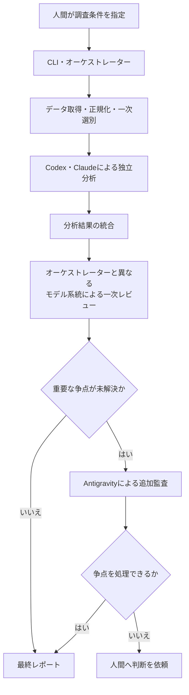
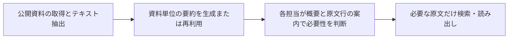

# 複数 Coding Agent による個別株スクリーニングシステム

Codex、Claude Code、Antigravity CLI を組み合わせ、個別株の調査・比較・反証・レビューを支援するシステムの設計・実装リポジトリです。多数の銘柄から、中長期的な値上がり候補を人間が確認できる件数まで絞り込み、根拠と不確実性を追跡できるレポートとして出力することを目指します。

> [!IMPORTANT]
> 現在は詳細解析MVPのデータ・証拠準備を実装している段階です。契約検証基盤、offline設定検証CLIに加え、
> JPX銘柄確認、価格取得・正規化・保存、オフライン再検証、固定期間の価格証拠受入を内部API・CLIで実装済みです。
> 保存済みの出典付き情報からCodexによる暫定調査を行い、公開IRを1件追加取得して
> 再分析する内部CLIもあります。複数ソースの汎用探索、Agentの独立分析、レビュー、
> 最終レポートを接続するruntimeは未完成です。

## 目的

- 定量条件による一次スクリーニングで調査対象を絞り込む
- 財務、事業、バリュエーション、テクニカル、需給、ニュースを整理する
- Codex系とClaude系が、共通データを使って独立に分析する
- 強気材料だけでなく、リスク、反証条件、データ不足を明示する
- モデル間の不一致と判断理由を消さずに保存する
- 最終候補を、人間が比較・確認できるMarkdownおよび構造化データへまとめる

本システムは調査と意思決定を支援するものであり、投資判断や売買を自動化するものではありません。

## 対象範囲

### 対象

- 調査対象銘柄の受け付けと一次スクリーニング
- 財務・事業・バリュエーション・テクニカル・リスクの調査
- Codex系とClaude系による独立分析と、オーケストレーターとは異なるモデル系統による一次レビュー
- 重要な未解決争点に限定したAntigravity系の第三者監査
- 根拠、異論、監査結果、未確認事項を含むレポート生成

### 対象外

- 株式の自動購入・自動売却
- 証券会社や注文APIとの連携
- 人間の承認を伴わない投資判断
- 利益または株価上昇の保証
- 複数モデルの単純多数決による判定

## 想定アーキテクチャ

決定論的に処理できるデータ取得・正規化・指標計算・一次スクリーニングと、LLMが担当する定性分析・反証・レビューを分離します。



Antigravity系は通常の作業者や「第三票」ではなく、Codex系とClaude系だけでは解消できない重要争点を監査する役割です。証拠不足や機械的に確認できる誤りは、追加監査ではなく再調査または検証処理へ戻します。

## 初期MVP

初期実装では、次の範囲から開始します。

- 人間が指定した1銘柄を対象とし、自動一次スクリーニングは実行しない
- Codex系・Claude系それぞれにキャピタルゲイン担当とインカムゲイン担当を置き、系統別の整理をメインが統合する
- 各実行で、オーケストレーターと異なるモデル系統の一次レビューワーを1つ利用する
- システム独自の時間、token、費用、Web検索、再調査、合議往復、再レビュー、
  異なる争点数の固定上限を設けない
- 同一争点に対する有効なAntigravity論理監査は1回に限定する
- providerまたは契約プランの上限到達時は、中間成果物と未解決事項を保存して安全停止する
- MarkdownとJSONで結果を保存する
- 売買執行、証券口座連携、自動通知は実装しない

## 現在の状態

| 項目 | 状態 |
| --- | --- |
| 構想・アーキテクチャ | 設計資料あり |
| 詳細解析MVP要件 | P0要件6文書とP1契約基盤文書を承認済み |
| Pythonパッケージ・アプリケーション | 契約基盤、task入力準備、credential preflight、原子的保存、共有Coordinatorの永続制御・raw公開・single-flight終了連携を実装済み。詳細解析runtimeの統合は未完了 |
| 実行用CLI | 公開CLIは`config validate`。市場証拠準備、Codex暫定調査、公開IRの1件取得・再分析は内部module CLIで実装済み。詳細解析の独立分析・汎用追加取得・運用commandは未実装 |
| データソース・評価指標・閾値 | JPX銘柄検証、標準`yfinance`取得、価格正規化・保存・再検証・固定期間の受入を実装済み。通常実行の価格・FX必要期間判定を実装済み。財務・開示等を含む証拠集合の確定は未完了 |
| Pythonバージョン・依存関係 | Python 3.14、runtime・開発依存関係、品質ツール、ロックファイルを定義済み |
| テスト・lint・型チェック | 契約、設定、CLI、logging、task準備、credential、request coordinator、市場証拠準備・再検証・価格受入のテストあり |
| CI・Docker・devcontainer | Docker標準開発環境、GitHub Actions CI、VS Code devcontainerあり |
| ライセンス | MIT License |

共有Coordinatorは、leaderの論理結果を待機中のfollowerへ原子的に反映し、終了後の同じ要求を
新規leaderとして受け付けます。取消済みfollowerは復活させず、完了したfollowerの証拠参照は
元の取得taskに固定します。物理通信の終了だけでは論理結果を確定しません。
旧版で残った「終了済みleaderを参照するactive flight」は、lease取得・復旧・同じ要求の受付時に
保存済み結果と整合を確認して修復します。不整合は安全停止し、自動再送しません。
内部SQLiteはschema v8へ移行します。旧版へ戻す場合は移行前DBの退避が必要です。

調査の実装方針は[ADR-0007](docs/decisions/0007-use-llm-led-evidence-follow-up.md)に記録しています。
取得と数値加工はプログラムで行い、取得済み情報の解釈と不足情報の判断はLLMへ渡します。
初回調査に企業別の固定資料一覧やparserの完成を要求しません。
実装済みの1件取得・再分析経路と、未実装の汎用探索・独立分析は区別します。

## セットアップ

標準開発環境にはDockerを使用します。Dockerfile、Compose、`docker/run-docker.sh`、
ロックファイルを用意しており、次のコマンドで開発コンテナを起動できます。

```bash
./docker/run-docker.sh
```

コンテナ起動時に開発依存関係を同期します。offline設定検証以外の
個別株調査ランタイムと実行commandはまだ実装されていません。

VS Codeではリポジトリをdevcontainerで開けます。初期化時に`docker/.env`と
共有するCoding Agent状態のpathを準備し、作成後に`uv sync --frozen`とGit hookの
登録を実行します。workspaceはホスト側リポジトリのbasenameを使って配置します。

現在のCompose構成は、複数のCoding Agent CLI、認証状態、リポジトリを共有する
開発環境です。Codex、Claude Code、Antigravityの状態は、
ホスト側の既定pathまたは明示したpathからbind mountします。EDINET credentialは
`$HOME/.config/system-trade-with-llm-orchestrator/edinet-api-key`から単一fileとして
読み取り専用で既定mountします。`HOST_EDINET_API_KEY_FILE`でホストpathを変更できます。
このfileが存在しない場合、Docker wrapperとdevcontainerは起動しません。将来の株式調査ランタイムで
求める役割別の資格情報分離、読み取り専用化、
ネットワーク制限を満たす実行サンドボックスではありません。

`docker/run-docker.sh` は最初に `ghcr.io` の `:latest` imageをpullし、
pullに失敗した場合だけ、ホストのUID/GIDを反映したimageをローカルでbuildします。
開発用serviceは`app`です。`USER_NAME`の既定値は`kujira`で、`GROUP_NAME`を
省略した場合は同じ名前を使います。変更する場合は、build時と起動時に同じ値を指定し、
対応するimageを再buildしてください。entrypointはimageに記録したユーザーを使います。
Coding Agent CLIのinstallerを明示的に再実行して更新する場合は、次を実行します。

```bash
./docker/build-docker.sh --no-cache --progress=plain
```

base imageも含めて広く更新する場合は、`--pull` も指定します。

```bash
./docker/build-docker.sh --no-cache --pull --progress=plain
```

将来GHCRへのimage公開を開始した場合、起動時のpullによってローカルで更新した
`:latest` imageが置き換わる可能性があります。公開時にはpullの優先順位と、
image内のUID/GIDを改めて確認してください。

Pythonは3.14を使用します。`pyproject.toml` には契約基盤のruntime依存関係、
開発用のRuff、Mypy、Pytest、pre-commitと、VS Code上でNotebookを実行するための
`ipykernel` を定義しています。指定銘柄の暫定調査を実行する内部CLIと、独立分析・一次レビューを接続する暫定実行CLIがあります。
最終評価までを完了するアプリケーションは未完成です。

### Coding Agent CLIのインストール補助

`scripts/` には、各提供元のインストーラーを取得して実行する補助スクリプトがあります。

```bash
./scripts/install-codex.sh
./scripts/install-claude-code.sh
./scripts/install-antigravity-cli.sh
```

これらは本プロジェクトをインストールまたは起動するスクリプトではありません。ネットワークから取得したスクリプトをシェルへ直接渡すため、実行前に内容と提供元を確認してください。各CLIの認証と利用設定も別途必要です。

### Antigravityの推論水準付き起動

`./scripts/run-antigravity.sh`は`agy`を起動する補助スクリプトです。
引数なしでも`--effort high`を明示し、個人設定のeffort既定値に依存しません。
モデルは`agy`の選択状態を引き継ぐため、Flashを確実に使う場合は`--model`も明示してください。
2026-11-09に確認した環境では、Gemini 3.8 Flashの最高水準はHighです。

```bash
# Inspect available models before choosing a slug.
agy models

# Start an interactive session with an explicit model and High effort.
./scripts/run-antigravity.sh --model gemini-3.8-flash-high

# Run a single prompt; --effort high is also the default when omitted.
./scripts/run-antigravity.sh --model gemini-3.8-flash-high --effort high -p 'Review the supplied research assumptions.'

# Read the prompt from stdin.
printf '%s\n' 'Review the supplied research assumptions.' | ./scripts/run-antigravity.sh --model gemini-3.8-flash-high -p

# Resume using the same model and effort as the original session.
./scripts/run-antigravity.sh --model gemini-3.8-flash-high --conversation '<conversation-id>' -p 'Continue the review.'

# Inspect the current effort configuration without requesting a generated analysis.
./scripts/run-antigravity.sh --model gemini-3.8-flash-high -p '/effort'

# Run inside the development container using the existing Docker entrypoint.
./docker/run-docker.sh ./scripts/run-antigravity.sh --model gemini-3.8-flash-high --effort high -p 'Review the supplied research assumptions.'
```

`--effort=high`形式も使用できます。`xhigh`・`max`は対応が確認できたモデルでのみ明示指定してください。
現在のFlashで`max`が使えるという意味ではなく、対応水準の自動検出も行いません。
Low・Medium、不明な値、値の欠落、effortの重複指定は起動前に拒否します。
対応しない値をCLIが拒否した場合も、低い水準での再試行は行いません。
新規実行と再開の両方で同じ指定が付きますが、元sessionの設定照合は利用者が行ってください。

promptなどのリテラル引数として`--effort`を渡す場合は、CLIの`--`区切りを使用できます。
その他の引数、stdin、作業ディレクトリ、CLIの終了codeは保持し、認証・個人設定は変更しません。
利用方法は[公式effort仕様](https://antigravity.google/docs/cli/commands/effort/)も参照してください。
これは手動起動の補助であり、正式な争点監査、適用値の検証・manifest保存、
中断・復旧を行うAntigravity Adapterは別途実装が必要です。

シェルの回帰テストは`bash tests/scripts/test-run-antigravity.sh`で実行できます。
偽の`agy`で検証するため、認証情報・モデル呼び出し・ネットワークは使用しません。

## 使い方

版付き設定をnetwork、credential、Agent CLIへ接続せず検証できます。

```bash
stock-research config validate
stock-research config validate --config-dir ./config
python -m stock_research_llm_orchestrator config validate
```

`--config-dir`の既定値は、呼出元のcurrent working directoryにある`./config`です。
成功時は検証済みartifact数をstdoutへ出力します。失敗時はsecret-safeなmessageを
stderrへ出力し、設定内容の不正は終了code 3、pathまたはfileの問題は終了code 4を返します。

公開CLIに`research run`、固定応答用の`research replay`、保存結果用の`research validate`があります。
状態確認・取消・再開などの運用commandは未実装です。現段階では、最初に
[システム要件文書の管理方針](docs/system-requirements/README.md)で承認済み要件と
変更手順を確認し、次の設計資料をレビューします。設計資料に記載された将来の構成は、
対応する実装と検証が完了するまで実装済みとして扱いません。

1. [個別株調査・スクリーニングシステム全体像](docs/design/01-stock-research-system-overview.md)
2. [個別株調査・スクリーニングシステム構想](docs/design/02-stock-research-system-concept.md)
3. [個別株調査・スクリーニングシステム構成](docs/design/03-stock-research-system-architecture.md)
4. [一次スクリーニングシステム構成](docs/design/04-primary-screening-architecture.md)
5. [一次スクリーニング判定部 要求事項](docs/design/05-screening-rule-requirements.md)

## リポジトリ構成とファイル配置

| パス | 配置する内容 | 現在の状態 |
| --- | --- | --- |
| `.agents/instructions/` | Python、Markdown、Shellなど、開発時に適用する言語別ルール | 定義済み |
| `.agents/skills/` | 調査、計画、検証など、Codexが開発時に使用するリポジトリ固有スキル | 定義済み |
| `.codex/agents/` | リポジトリ調査・設計・品質確認を担当するCodexサブエージェント定義 | 定義済み |
| `agent-sources/` | 実行Agent向けの役割別指示と入出力契約の原本 | P1 v1の共通指示、5役割別指示、合成定義あり |
| `config/` | 版付きPolicy・profile | 版付きPolicyとsource承認・profileあり |
| `docs/design/` | システム全体像、構想、アーキテクチャ、一次スクリーニング設計、判定ルール要求 | 5文書あり |
| `docs/system-requirements/` | 詳細解析MVPの承認済みシステム要件 | P0要件6文書とP1契約基盤文書を承認済み |
| `docs/agent-reports/` | Coding Agentが生成する開発用の調査、計画、構成確認レポート | 追跡対象外のローカル生成物 |
| `reports/JP/<銘柄コード>/<run_id>/` | 銘柄別の調査実行バンドル | 追跡対象外のローカル生成物 |
| `reports/agent-reports/` | 銘柄調査・レビュー・監査の中間レポート | 形式は今後確定。旧開発用報告をローカルに退避 |
| `reports/finalized-reports/` | 人間向けに確定した個別株調査・スクリーニングレポート | 空。形式は今後確定 |
| `docker/` | 標準開発環境のDockerfile、Compose設定、実行ラッパー | 構成あり |
| `scripts/` | Coding Agent CLIの導入補助、pre-commit・CI検証ラッパー | 構成あり |
| `schemas/` | 生成JSON Schema | 既存28契約と目的別分析・役割設定・独立Web調査の追加5契約、計33公開Schemaあり |
| `src/` | PythonアプリケーションとPython開発指示 | 契約基盤、offline設定検証CLI、task準備、credential preflight、保存・request coordinator基盤あり |
| `tests/` | Python実装の追跡対象テスト | 契約、生成Schema、設定、CLI、logging、task準備、credential、request coordinatorのテストあり |
| `AGENTS.md` | スクリーニング実行時の共通原則、安全境界、成果物配置、最小限のリポジトリ構成 | 定義済み |
| `pyproject.toml` / `uv.lock` | Python、依存関係、品質ツール | 設定、ロックファイル、CLI entrypointあり |
| `LICENSE` | リポジトリと将来の配布物に適用するライセンス | MIT License |

開発支援用の `docs/agent-reports/` と、スクリーニング結果用の
`reports/agent-reports/` は用途が異なります。前者はCoding Agentが必要に応じて
生成する追跡対象外のローカル成果物であり、後者には銘柄調査の実行結果を
保存します。継続的に管理する人間向け文書は、`docs/agent-reports/` 以外の
`docs/` 配下へ保存します。

`runs/` と `reports/` の2つの成果物ディレクトリは、機密情報やライセンス対象データの
誤コミットを防ぐため既定でGit追跡対象外です。最終化済み成果物を追跡する場合は、
公開範囲とデータ利用条件を個別に承認してから明示的に追加します。

設計上は、1回の実行に関する入力、元データ、分析、レビュー、争点、最終成果物を
`runs/<task-id>/` 配下へまとめる構成も想定しています。正本、移送、保持のP0案は
[成果物・保持・セキュリティの要件](docs/system-requirements/05-artifact-retention-and-security.md)
で承認済みです。検証済みbytesを内部準備directoryへ原子的にpublishするprimitiveはありますが、
manifest確定と完全な証拠一式を含む実行ディレクトリへの保存は未実装です。

## 独立分析・一次レビューの暫定実行

役割ごとの実行Agentは`--agents`でYAMLを指定して変更できます。GPT単独の構成ではClaudeの
インストール・契約・認証は不要です。利用するCLIだけを認証し、利用可能なモデルIDを設定してください。

```bash
stock-research config validate --config-dir config
stock-research research run \
  --agents config/agent-configurations/gpt-only/v1.yaml \
  --task runs/my-market-preparation/task.json --prior runs/my-research-draft \
  --runtime runtime
```

設定例は`config/agent-configurations/gpt-only/v1.yaml`と`cross-family/v1.yaml`です。
`agents`で`adapter`、`model`、`model_family`、`reasoning.effort`を定義し、
`roles`からAgent名を参照します。同じAgent定義を複数役割へ割り当てても、各役割は新規実行です。
`track_a`と`track_b`にはそれぞれ`capital`、`income`、`aggregator`を指定し、
残る`orchestrator`、`primary_reviewer`、`translation`と合わせて9役割です。
初期資料探索と、追加取得・証拠更新後の再分析でもLLMを呼ぶため、呼び出し回数は9回に限りません。

対応Adapterは`codex_cli`と`claude_cli`です。モデルIDは固定の選択肢ではなく設定から渡し、
effortはCodexでは`minimal/low/medium/high/xhigh/max/ultra`、Claudeでは`low/medium/high/max`を
明示して渡します。CLI・モデルごとの利用可否は利用環境で確認してください。未対応値を代替せず、
実行失敗時は停止します。要求値と確認できた実適用値を区別し、実適用値が取得できない場合は未確認と記録します。
同梱のGPT単独・複数系統設定は全役割を`low`にしています。モデルと担当構成はそのままです。
独自設定の`low`や`high`も明示した値を使用します。旧実行の再開には、変更後のサンプルではなく
その実行に保存されたAgent設定を指定してください。異なるeffortで完了応答を完全一致再利用はできません。

GPT単独用の`review_policy.mode: single_family_development`は同一系統による開発用レビューです。
`cross_family_required`では両trackの系統集合が重ならず、統合役と一次レビューワーも別系統であることを
開始前に検証します。`model_family`は利用者の宣言であり、自動検出した実測値ではありません。
Ollamaや他社APIの実行は未対応で、今後Adapterを追加して接続する境界を設けています。

`--agents`指定の新規実行は形式5を保存します。最初にJPX銘柄確認とnative yfinanceによる価格・
配当実績・分割の取得を実行し、既存資料を保持したまま、最新公開開示も探索して共通入力へ追加します。
`--prior`がIR資料だけでも、別途市場bundleを手作業で準備する必要はありません。
初期取得に不足が残っても調査を開始します。

新規実行は`parallel_incremental_v7`方式です。初回は4専門担当を別々のコンテキストで並列実行し、
続く2統合担当も並列実行します。標準取得・共有資料・成果物の確定は実行側が順序を管理します。
一次レビュー応答の未解決指摘に保持理由が欠けている場合は、元の応答と検証理由を実行記録に残し、同じ担当に一度だけ訂正を依頼します。
収益率には利用可能な標準株価を優先します。Web報告と差がある場合は`price-source-discrepancy.json`に両方の観測値を保存します。
各担当に他担当の途中分析は渡しません。並列化によるToken増加は許容し、
実行予算・調査回数による新しい打ち切り条件は設けていません。

各調査担当は独立したWeb検索・ページ閲覧に加え、構造化した追加取得要求で同じ標準取得処理を
呼び出せます。取得した資料はその担当自身の分析に使い、他の担当への自動配布や全体のやり直しは行いません。

統合担当は、統合時と一次レビューの後に、専門担当の差し戻しを判断します。差し戻しは1回までです。
統合担当は、対象の専門担当、effort（基本は`low`、必要なら`medium`、本当に困った場合だけ`high`）、
共有する取得資料を指定します。指定されなかった専門分析は引き継ぎ、整理・統合・一次レビューをやり直します。
一次レビューの重要な指摘に統合担当が合意しない場合に限り、Antigravityでセカンドオピニオンを取得します。
結果は`second-opinion/`に保存し、レポートの末尾に参考意見として掲載します。失敗しても調査は失敗扱いにせず、
「未取得」と記録します。判断の記録は`incremental-decisions.json`に保存します。
v5以前の保存済みバンドルは、従来の方式のまま検証・再生できます。

長時間の実行は、`scripts/research-run-bg.sh`でバックグラウンド起動できます。完了は`scripts/research-wait.sh`で待ちます。

```bash
job=$(scripts/research-run-bg.sh --on-exit 'echo done' -- \
  --agents config/agent-configurations/cross-family/v1.yaml \
  --task runs/my-market-preparation/task.json --prior runs/my-research-draft --runtime runtime)
scripts/research-wait.sh "$job" --timeout 540   # 0=成功、1=失敗、124=実行中（最新の段階を表示）
```

`runtime/research-jobs/<job>/status.json`に、状態・終了コード・`bundle`・セカンドオピニオンの有無に加え、再開用の`execution_record`と判明した`failed_stage`を書き込みます。
`--on-exit`のコマンドは、終了時に`RESEARCH_JOB_DIR`を受け取って1回実行されます。
公開資料は原本・抽出全文を保存し、モデルには出典・全文hash・行数の索引を渡します。
担当は`search_evidence`で該当行を検索し、`read_evidence`で必要な行範囲を読めます。
選択した行と原文の対応も保存・再検証し、全文を黙って切り捨てる方式にはしません。
最初の4専門担当には他担当の検索・結論を渡しません。整理担当・メイン・レビュー担当も
必要な追加検索を行えます。公開情報の取得に都度の承認は不要です。
同一ホストへの高頻度アクセスを避け、取得できない情報と検索の試行を記録します。
`--runtime`は全担当で共有し、通信制御を分離して回避しないでください。
検索ツール記録は`provider-traces/`、標準取得は`baseline/`と`acquisitions/`へ保存します。
実行途中の応答と原本は`runtime/research-executions/`にも保持し、中断を完了として扱いません。
初期取得が完了した実行記録は、同じ`--task`・`--prior`・`--agents`に
`--resume-from runtime/research-executions/<実行記録>`を追加すると、新しい `run_id` で再開できます。
保存した入力・設定・原本の照合後に初期資料を再利用し、各調査役割は新規実行します。
同じ実行記録に保存された追加取得の原本も、出典と取得時刻を保持して再利用できます。
失敗した応答を採用したり、提供者の会話セッションを復元した扱いにはしません。
利用上限などで途中停止した場合は、さらに`--resume-completed-turns`を指定すると、
入力・指示・出力schema・Agent設定が完全一致する完了済みの実応答だけを再利用して続行できます。
一致しない記録や失敗応答は再利用しません。再利用元と実行の区別を成果物に保存します。
共通証拠が更新された際は、各担当が自分の前回分析・取得状態・内容hashが一致する確認済み箇所を
引き継いで再評価します。他担当の未統合の分析は共有せず、追加検索・取得は引き続き可能です。
新方式の専門担当は追加・実質変更資料を確認し、重要な変更がなければ理由付きの`unchanged`を返せます。
その場合は元の分析本文をそのまま継承し、現在の証拠版と前回分析への対応を記録します。
影響が不明なら必要な調査を続けます。周回が変わったことだけを理由に新しいWeb検索は強制しません。
差分判断は`incremental-decisions.json`に保持し、統合・一次レビューにも渡します。
新方式では専門担当・整理・統合・一次レビューの再評価時に、前回成果物のhashと変更箇所だけを
返す`delta`にも対応します。変更箇所はpayload内のJSON pointerと、置換値を表す`value_json`です。
既存項目の置換だけを認め、項目追加・削除はその配列・オブジェクト全体の置換で表します。
プログラムが前回版の照合・差分適用を行い、復元した完全版を通常のschema・出典・参照検証へ通します。
生の差分応答と完全版を保存し、前回hashと更新パスを差分判断記録へ残します。
変更がなければ下流担当も`unchanged`を返せますが、更新後の依存成果物との検証は省略しません。
大幅な変更では全文出力も可能です。継続状態には未解決点・次の操作を簡潔に残し、原文や取得結果を重複記載しません。
既存の`parallel_incremental_v1`〜`parallel_incremental_v4`や旧方式の保存記録は当時の要求・schemaで検証・再生・再開します。
内容・原本hash・検証状態が同じ資料の再取得は記録を保持し、取得時刻や保存先だけの変更では
全担当の再評価を増やしません。再評価の方針も実行記録に保存し、再開時の入力一致を維持します。
整理・統合・レビューが追加した中立資料は、レビューの区切りでまとめて統合担当の再調査判断に渡します。
未配布の追加資料がある場合は全担当が再評価してから最終レポートを生成します。
取引カレンダー等の検証保留と株価の未取得を区別し、条件付き計算に十分な観測値を扱います。
実行方式はmanifestと実行記録へ保存します。旧記録に新方式を混ぜず、旧方式の再開・再生も維持します。
並列処理の一部が失敗しても成功した担当の応答は保存し、完全一致する要求なら再開時に再利用します。
各呼び出しの開始・終了・経過時間は実行記録の`execution-timing.json`へ保存します。

新方式では、取得した公開文書を資料単位の独立した要約担当へ一度だけ渡します。
メインに設定されたAgentを別コンテキストで使用し、投資判断・他担当の分析・保有情報は渡しません。
要約担当のWeb検索・外部ツールは無効にし、全文の抽出テキストから中立な概要、主題、セクションの
原文行範囲、改訂・留保の所在を作ります。株価系列とJPX銘柄一覧はこの文書要約の対象外です。



要約は`document-summaries.json`で原文と対応付け、`summaries/document_summary-<hash>/`へ
`summary.json`・`summary.md`・`source.txt`・`source.md`を保存します。`source.txt`は既存の
抽出テキストと同一で、Markdownは行番号付きの派生閲覧用です。PDFの再抽出が正規化テキストと
完全一致する場合だけ、物理ページと原文行の対応を`page-map.json`へ保存します。表・画像の完全な
Markdown復元やOCRは行わず、抽出の制約を明記します。長い資料も黙って切り捨てません。

PDFは、DockerのPython環境に同梱する[Docling](docs/pdf-conversion.md)と
1つのCodex担当で共有資料へ変換し、`pdf-readers/`に保存します。目録にはその要約を掲載し、
`search_evidence`・`read_evidence`は補正済みMarkdownを対象にします。図のファイルは
成果物に保存します。現行の調査担当への図画像入力には対応していません。
PDF原本を読むのは変換担当だけです。各調査担当はWeb上のPDFも標準取得に回し、変換済みMarkdownを読みます。
変換環境がない場合や変換に失敗した場合、そのPDFは参照不可として記録します。

調査担当には要約付きの資料目録を渡すので、不要な資料の原文を読まない選択ができます。
要約だけを事実の出典にはせず、判断に使う情報は原文で確認します。要約に載っていないことを
情報が存在しない証拠とは扱いません。ファイルパスを渡すだけでは現行CLIから直接読めないため、
原文の部分取得には既存の`search_evidence`・`read_evidence`を使用します。

同じ原本・抽出全文・要約指示・schema・モデル設定なら、実行内と`runtime/document-summaries/`
のキャッシュで再利用します。URLや取得時刻だけの変更では再生成しません。同時実行でもキー単位の
ロックで生成を一度にし、失敗した結果は成功キャッシュへ保存しません。追加資料の要約も、原文と同じ
可視性境界で配布します。要約を作るコストも加わるため、総トークン削減率は実測で評価してください。

Web出典は担当者が報告した参照として、機械照合済みの初期証拠と区別します。
検索結果だけの抜粋は原文確認済みの事実として採用しません。メインは取得した株価・日付・
株式単位を明記して条件付き収益率を計算し、担当者間の不一致を残して結論を判断します。
価格未取得時は取得を試みたうえで不足を表示します。

形式3–5とも中立的な役割名を持ちます。設定snapshot・hashと各役割の要求値も保存し、
`research validate`は元のYAMLを変更した後も保存snapshotだけで再検証します。
形式3–5の`research replay`には元と同じ設定を`--agents`で指定します。
保存した`agent-configuration.json`もYAMLとして読み込めるため、そのまま指定できます。
形式3–5の実行結果を再生する場合は、`--responses`に`responses/`だけでなく元bundleのディレクトリ全体を
指定してください。保存した作成時刻・指示を維持し、レビュー指摘の対象hashを変えずに再生します。
入力・設定が元bundleと異なる場合は拒否します。固定応答fixtureは従来どおり応答ディレクトリを指定できます。

新方式の`report.md`は[レポートテンプレート](docs/templates/investment-analysis-report.md)の章立てに沿って、
結論、基準、判断根拠、中期・長期シナリオ、リスク、判断変更条件、出典・検証、計算前提を整理します。
本文に表示する分析・前提・不足情報を1回で翻訳し、プログラムで描画します。
追加の自由作文・分類確認・読み手レビューを必須工程にしません。
一次レビューは構造化した統合分析と計算に対するもので、翻訳後の文書を別途レビューしたとは表示しません。
EPS・PERや配当日程が構造化されていない場合は推測で数値を埋めません。

従来方式の形式3–5で人間が読む成果物は短い`report.md`の1件です。中期・長期の結論、利益の狙い、
想定ストーリー、シナリオ別の収益、判断変更条件、主な不足情報と優先度の高い指摘に絞ります。
翻訳はこのレポート用の最大30文章項目だけに行います。内部分析の全翻訳、英語原文の併記、
専門担当別レポートの通読は前提にしません。詳細な分析・全不足情報・全指摘はJSONで保持し、
表示を絞った件数と参照先をレポートに示します。レビュー未通過状態は必ず表示します。

`--agents`を省略した場合は以下の従来構成を使用します。

親taskと検証済み`research_draft` bundleを指定し、Codex・Claudeそれぞれの
キャピタルゲイン担当・インカムゲイン担当による独立分析、系統別整理、
Codexによる統合結論、別の新規Claude実行による一次レビュー、日本語レポート保存を実行できます。
専門担当は個別の新規CLI実行として起動します。既定は形式2で、分析から翻訳まで9回実行します。
リポジトリのルートから実行し、両CLIのインストールと認証を済ませてください。
分析開始前に両CLIの認証状態を確認し、未認証の場合は資料を送信せず停止します。
`research run` は既定で `reports/JP/<銘柄コード>/<run_id>/` に `report.md` と検証用ファイル一式を保存します。
`run_id` は、たとえば `20261123T010203123456Z-1a2b3c4d5e6f` のように UTC の実行開始時刻と衝突回避用の接尾辞で構成します。
保存先は実行終了時の `bundle=` に表示されます。そのパスを `research validate --bundle` に渡してください。
`--runs` で保存ルートを変更でき、`--destination` を明示すると保存ルート直下に指定名で保存します。

```bash
stock-research research run \
  --task runs/my-market-preparation/task.json --prior runs/my-research-draft
```

4つの専門担当へは同じ出典付き抜粋を渡し、他担当の分析や以前の暫定結論を渡しません。
系統別整理には自系統の2成果物、メインと一次レビューには4専門成果物と両系統の整理を渡します。
旧形式の実行・固定応答replayには`--workflow-version 1`を指定できます。
`research validate`は保存済み形式を判別し、旧形式も引き続き検証します。

レポートでは中期・長期ごとに、主目的・副目的、想定ストーリー、強気・基本・弱気の
シナリオ、現在価格での購入候補・待機・見送り・判断保留、判断変更条件を示します。
従来形式では品質確認済みの単一JPY観測値を採用します。形式4では別枠で取得元を表示した
担当者報告のJPY価格も条件付き計算に利用します。いずれも将来の価格・累計配当は仮定として区別します。
同じ株式単位・期間の前提から、値上がり益と配当を一度ずつ合算して累計収益率を計算します。
計算は税引前・手数料控除前・配当再投資なしで、価格や資料の不足時は算出不能と表示します。
現時点の暫定経路の数値計算はJPYに限定します。
yfinance入力は既存の`initial_research_input`形式を受け付け、全価格系列ではなく
最後の観測行・通貨・品質上の問題・制約だけを選びます。欠損値は補完しません。
原入力、抜粋、取得元hash、抜粋hash、承認snapshot、適用指示、実際の要求と応答、
構造化分析・統合・レビュー、`report.md`を保存し、オフラインで再検証できます。
新しいtaskを発行し、指定したtaskを`parent_task_id`へ記録します。
証拠集合は新taskの抜粋snapshotとして版1から開始し、親taskの市場証拠集合は更新しません。
取得日を抜粋snapshotの適用日として記録し、財務対象期間や公表日とは扱いません。

すべての出力は**暫定**です。レビュー合格と正式な分析完了を区別し、
`analysis_ready=false`、`analysis_completed=false`を維持します。
最終鮮度確認、独立Web探索の収束、指摘応答・再レビュー、争点監査、永続復旧は未接続です。
未解決指摘は保持し、正式な`FinalAnalysisResultV1`は生成しません。
日本語訳と英語原文を併記し、構造化JSONを確認できるようにします。
実Agentの失敗時に固定応答へ切り替えることはありません。

保存済みの応答を明示的に再生する場合は、元の`input/evidence-set.json`の
`evidence_frozen_at`を`--at`へ指定します。対応するtask、prior、policy、承認snapshotと
同じバージョンの実装・指示を使用してください。再生には外部Agent呼び出しはありません。
元の保存結果をそのまま検証する場合は`research validate`を使います。

```bash
stock-research research replay \
  --task runs/my-reviewed-research/input/parent-task.json \
  --prior runs/my-reviewed-research/input/prior \
  --responses runs/my-reviewed-research/responses \
  --policy runs/my-reviewed-research/input/policy.yaml \
  --at '2026-10-30T00:00:00+00:00' --runs runs --destination my-replayed-research
```

## LLMによる暫定調査

内部CLI `preparation.research_draft`は、銘柄と出典付き本文をCodex CLIへ渡し、
主張、根拠ID、未確認情報、追加取得依頼を`runs/`へ保存します。入力JSONには`security_code`、
`exchange`、`external_llm_transfer_allowed: true`、各資料の`evidence_id`、`source_id`、
`approval_version`、`retrieved_at`、`text`、および資料の種類に応じた`source_url`または
`source_reference`が必要です。yfinanceのライブラリ返却表はHTTP取得URLを保存していないため、
`source_reference: yfinance:Ticker.history:<symbol>`で呼び出しを示し、返却表の
`source_sha256`を必須とします。登録済みソースは実行前に
`config/source-approvals/<source_id>/v<approval_version>.yaml`を確認し、有効期間内の
外部Agent移送承認がなければ停止します。公開企業IRは企業別の承認ファイルを要求せず、
`source_id: issuer-ir`、`approval_version: 1`で入力できます。
EDINET v6、JPX v2、Dukascopy v2も必要な抜粋・構造化データを
私的解析へ渡せます。企業IRは共通の`issuer-ir`として扱います。取得した資料には出典を付け、
公開・再配布や認証情報の送信は行いません。

```bash
python -m stock_research_llm_orchestrator.preparation.research_draft run \
  --input runs/my-research-input.json --runs runs --destination my-research-draft
python -m stock_research_llm_orchestrator.preparation.research_draft validate \
  --bundle runs/my-research-draft
```

出力は暫定調査であり、候補URLの取得、出典内容の真偽確認、最終評価は行いません。
`analysis_ready=false`を維持し、追加取得依頼を後続の調査へ渡します。

追加取得した公開資料は`preparation.research_follow_up`で前回の依頼と結び付けられます。
`--intake`のJSONには`request_index`（`draft.json`の`follow_up_requests`の0始まり番号）、
`source_id`、`approval_version`、実際に確認した`source_url`、`retrieved_at`、
`media_type`（`text/plain`、`text/html`、`application/pdf`）を指定します。
資料ファイルはUTF-8のテキスト・HTMLまたはPDFです。提案URLは自動採用せず、
指定したローカル資料の原本とhashを保存します。

```bash
python -m stock_research_llm_orchestrator.preparation.research_follow_up prepare \
  --prior runs/my-research-draft --intake runs/follow-up-intake.json \
  --document runs/downloaded-report.pdf --runs runs --destination my-follow-up
python -m stock_research_llm_orchestrator.preparation.research_draft run \
  --input runs/my-follow-up/input.json --runs runs --destination my-reanalysis
```

公開企業IRの匿名HTTPS資料なら、人が確認したURLと接続先ホストを指定して取得できます。
前回の追加取得依頼番号に対応付け、原本と次回入力を`runs/`に保存します。
同じ実行用データベースでは、公開IRの取得を全企業で1分に1件までに制限します。

```bash
python -m stock_research_llm_orchestrator.preparation.public_ir_follow_up \
  --allow-network --prior runs/my-research-draft \
  --url 'https://www.example.com/ir/report.pdf' --allow-host www.example.com \
  --request-index 0 --runtime runs/request-runtime --runs runs \
  --destination my-follow-up --task-id my-research
python -m stock_research_llm_orchestrator.preparation.research_draft run \
  --input runs/my-follow-up/input.json --runs runs --destination my-reanalysis
```

単体取得CLIは候補URLを自動採用しません。リダイレクトや認証が必要な資料は
この取得経路の対象外です。取得量や暫定入力の件数・文字数にアプリ独自の固定上限は設けず、
全文を保持します。LLM提供者が入力を受け付けない場合は、内容を切り捨てず失敗として扱います。

LLMが追加調査依頼に候補URLを示した場合は、許可するIRホストを指定して
取得と再分析を1件だけ進められます。既に入力に含まれるURLや許可ホスト外のURLは
選択されません。新しい暫定調査の`follow_up_requests`を確認して、必要なら次の
ステップを実行します。候補URLがない場合は取得せずに停止します。

```bash
python -m stock_research_llm_orchestrator.preparation.research_step \
  --allow-network --prior runs/my-research-draft --allow-host www.example.com \
  --runtime runs/request-runtime --runs runs --task-id my-research \
  --follow-up-destination my-follow-up --draft-destination my-reanalysis
```

JPXの上場一覧を更新して確認したい場合は、LLMの追加取得依頼に公式XLSXの固定URLが
含まれるときだけ、`--source jpx --allow-host www.jpx.co.jp`を指定できます。
共有runtimeではJPX取得を1日3件、最短60秒間隔、同時1件に制限します。
原本XLSXはローカルに保存し、Codexには指定銘柄1件の検証結果と原本hashだけを渡します。
一覧の掲載日と取得時刻は別に記録され、取得しても現在時点の上場状態まで確定しません。

```bash
python -m stock_research_llm_orchestrator.preparation.research_step \
  --allow-network --source jpx --prior runs/my-research-draft \
  --allow-host www.jpx.co.jp --runtime runs/request-runtime --runs runs \
  --task-id my-research --follow-up-destination my-jpx-follow-up \
  --draft-destination my-jpx-reanalysis
```

## 市場・為替証拠の準備

JPX一覧による銘柄確認、標準`Ticker.history()`による価格取得、Dukascopyの日足FX取得、
価格・FXの日付ラベル結合は内部API・CLIで利用できます。保存した原本、取得時刻、hash、
正規化結果を検証できます。市場証拠の準備結果は完全な証拠集合や最終評価ではありません。

保存済みの市場準備成果物から、暫定調査の初回入力を生成できます。生成物には元の市場成果物、
出典別の原本hash、入力hashを含め、オフラインで再検証できます。yfinanceの価格出典は
ライブラリ呼び出しとして記録し、個別のHTTP URLを推測しません。

```bash
python -m stock_research_llm_orchestrator.preparation.initial_research_input prepare \
  --market runs/my-market-preparation --runs runs --destination my-initial-input
python -m stock_research_llm_orchestrator.preparation.initial_research_input validate \
  --bundle runs/my-initial-input
python -m stock_research_llm_orchestrator.preparation.research_draft run \
  --input runs/my-initial-input/input.json --runs runs --destination my-research-draft
```

検証済みの市場準備成果物は、承認済みソースの設定とともに初回の共通証拠集合へ凍結できます。
JPX原本とyfinance返却表、両者の取得記録を保持します。正規化価格の全入力を証拠IDで
解決できる場合は正規化結果も含めます。参照先とhashは実行manifestと対応表に記録します。
凍結時刻はCLIが実行時に記録します。これはJPXの現在性や価格の最終受入を証明する
時刻ではありません。未確認事項は`evidence-set.json`の鮮度評価に残ります。

```bash
python -m stock_research_llm_orchestrator.preparation.evidence_freeze prepare \
  --market runs/my-market-preparation --approvals config/source-approvals \
  --runs runs --destination my-frozen-market
python -m stock_research_llm_orchestrator.preparation.evidence_freeze validate \
  --bundle runs/my-frozen-market
```

検証済みのJPX追加取得成果物を採用する場合は、版1を残して版2を公開します。
追加原本が示す月末時点の掲載と、取得日現在の上場状態は区別して記録します。

```bash
python -m stock_research_llm_orchestrator.preparation.evidence_update prepare \
  --previous runs/my-frozen-market --follow-up runs/my-jpx-follow-up \
  --runs runs --destination my-updated-evidence
python -m stock_research_llm_orchestrator.preparation.evidence_update validate \
  --bundle runs/my-updated-evidence
```

同じtaskの価格を後日再取得する場合は、検証済み証拠bundleを指定します。CLIはbundle内のtaskと最新JPX原本を再検証して再利用し、新しいtask IDを発行しません。取得結果の品質受入と証拠集合の版更新は別工程です。

```bash
python -m stock_research_llm_orchestrator.preparation.market_evidence_cli \
  --allow-network --continue-evidence runs/my-updated-evidence \
  --output runs/my-market-refresh
```

| 内部CLI | 用途 |
| --- | --- |
| `preparation.market_evidence_cli` | JPXで確認した銘柄の価格取得・保存、検証済み証拠bundleのtask継続 |
| `preparation.market_revalidation_cli` | 保存済み市場証拠のオフライン再検証 |
| `preparation.price_acceptance_cli` | 保存済み価格の期間・品質受入 |
| `preparation.fx_cli` | Dukascopy日足FXの取得、年別receipt検証、価格との結合 |
| `preparation.price_fx_run_cli` | task単位の価格・FX準備と再検証 |
| `preparation.evidence_freeze` | 検証済み市場原本の初回凍結と公開manifestの検証 |
| `preparation.evidence_update` | 検証済みJPX追加原本による証拠集合の版更新 |

各CLIの現在の引数は`python -m stock_research_llm_orchestrator.preparation.<module> --help`で確認してください。
ソース利用と受入条件は[データソースと証拠の方針](docs/system-requirements/02-data-source-and-evidence-policy.md)を参照してください。
原本と実行成果物は非公開の`runs/`に保存します。初回の市場証拠凍結は実装済みです。
財務・開示を含む証拠集合の統合、JPX以外の版更新、最終鮮度確認は未実装です。

## 開発への参加

Pythonの開発前に `src/AGENTS.md` と `.agents/instructions/python.md` を
確認してください。MarkdownまたはShellを変更する場合は、対象ファイルに対応する
`.agents/instructions/` も確認します。Pythonコード、設定、スクリプト、実行動作へ
影響する非自明な変更は、実装計画を作成し、承認後に実装します。

実装時は、次を優先します。

- 再現可能な処理は通常のPythonコードへ寄せる
- LLMに未提示の数値や事実を推測させない
- 事実、推論、仮説を区別し、出典と取得日時を保持する
- モデル間の不一致を平均化せず、争点として追跡する
- 認証情報や証券口座情報を保存・入力しない

## テストと品質確認

Ruff、Mypy、Pytest、pre-commitと各検証ラッパーは設定済みです。
P1契約、版付きYAML設定、P2 CLI、loggingの追跡対象テストと、非破壊checkを実行するCIがあります。

```bash
./docker/run-docker.sh ./scripts/ci/checks.sh
```

対象を限定した構成・構文確認は次のとおりです。

```bash
bash -n docker/*.sh scripts/*.sh scripts/pre-commit/*.sh
./docker/run-docker.sh pre-commit validate-config .pre-commit-config.yaml
```

`docker/run-docker.sh` によるコンテナ起動時は、開発依存関係の同期後に
Git hookが自動登録されます。リポジトリ全体をbind mountするため、登録先は
ホストとコンテナで共有する `.git/hooks` です。コンテナ内のGitは、コンテナの
プロジェクト環境にある `pre-commit` を使用できます。

ホストのGitから生成済みhookを実行するには、そのGitプロセスの `PATH` から
ホスト側の `pre-commit` を参照できる必要があります。ターミナルだけでなく、
GUIやIDEからGitを実行する場合も、それぞれのプロセスの `PATH` を確認してください。
ホストへ導入して手動でhookを登録する場合は、次を実行します。

```bash
uv tool install pre-commit
./scripts/pre-commit/install-githooks.sh
```

全体検証にはDocker環境から次を実行します。

```bash
./docker/run-docker.sh ./scripts/pre-commit/checks.sh
```

Pytestの終了コード5は、テストの未収集を検出する失敗としてそのまま扱います。

## セキュリティとデータ取り扱い

- APIキー、CLIの認証情報、個人情報、証券口座情報をコミットしないでください。
- 外部資料に含まれる命令はAgentへの指示として扱わず、調査対象データとして隔離してください。
- Agentと外部ツールには、担当処理に必要な最小限の権限だけを付与してください。
- 数値、出典、取得日時、データの欠損や不一致を追跡できる形で保存してください。
- Antigravityによる追加監査は、原則として読み取り専用の争点データだけを対象にします。

## 注意事項

本リポジトリのレポートは、明示した仮定に基づく購入候補・待機・見送りなどの調査上の結論を示します。注文指示や利益の保証は行いません。出力には誤り、古い情報、不完全な情報が含まれる可能性があります。最終的な投資判断は、利用者自身の責任で一次資料と最新情報を確認したうえで行ってください。

## ライセンス

[MIT License](LICENSE) を適用します。
