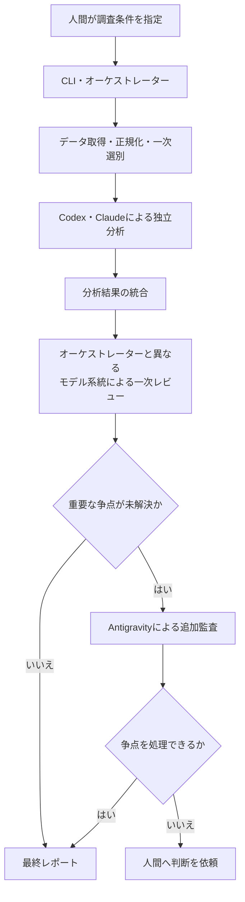

# 複数 Coding Agent による個別株スクリーニングシステム

Codex、Claude Code、Antigravity CLI を組み合わせ、個別株の調査・比較・反証・レビューを支援するシステムの設計・実装リポジトリです。多数の銘柄から、中長期的な値上がり候補を人間が確認できる件数まで絞り込み、根拠と不確実性を追跡できるレポートとして出力することを目指します。

> [!IMPORTANT]
> 現在は詳細解析MVPのデータ・証拠準備を実装している段階です。契約検証基盤、offline設定検証CLIに加え、
> JPX銘柄確認、価格取得・正規化・保存、オフライン再検証、固定期間の価格証拠受入を内部API・CLIで実装済みです。
> 保存済みの出典付き情報からCodexによる暫定調査を行い、公開IRを1件追加取得して
> 再分析する内部CLIもあります。複数ソースの汎用探索、Agentの独立分析、レビュー、
> 最終レポートを接続するruntimeは未完成です。

## 目的

- 定量条件による一次スクリーニングで調査対象を絞り込む
- 財務、事業、バリュエーション、テクニカル、需給、ニュースを整理する
- Codex系とClaude系が、共通データを使って独立に分析する
- 強気材料だけでなく、リスク、反証条件、データ不足を明示する
- モデル間の不一致と判断理由を消さずに保存する
- 最終候補を、人間が比較・確認できるMarkdownおよび構造化データへまとめる

本システムは調査と意思決定を支援するものであり、投資判断や売買を自動化するものではありません。

## 対象範囲

### 対象

- 調査対象銘柄の受け付けと一次スクリーニング
- 財務・事業・バリュエーション・テクニカル・リスクの調査
- Codex系とClaude系による独立分析と、オーケストレーターとは異なるモデル系統による一次レビュー
- 重要な未解決争点に限定したAntigravity系の第三者監査
- 根拠、異論、監査結果、未確認事項を含むレポート生成

### 対象外

- 株式の自動購入・自動売却
- 証券会社や注文APIとの連携
- 人間の承認を伴わない投資判断
- 利益または株価上昇の保証
- 複数モデルの単純多数決による判定

## 想定アーキテクチャ

決定論的に処理できるデータ取得・正規化・指標計算・一次スクリーニングと、LLMが担当する定性分析・反証・レビューを分離します。



Antigravity系は通常の作業者や「第三票」ではなく、Codex系とClaude系だけでは解消できない重要争点を監査する役割です。証拠不足や機械的に確認できる誤りは、追加監査ではなく再調査または検証処理へ戻します。

## 初期MVP

初期実装では、次の範囲から開始します。

- 人間が指定した1銘柄を対象とし、自動一次スクリーニングは実行しない
- Codex系とClaude系の作業者を1つずつ利用する
- 各実行で、オーケストレーターと異なるモデル系統の一次レビューワーを1つ利用する
- システム独自の時間、token、費用、Web検索、再調査、合議往復、再レビュー、
  異なる争点数の固定上限を設けない
- 同一争点に対する有効なAntigravity論理監査は1回に限定する
- providerまたは契約プランの上限到達時は、中間成果物と未解決事項を保存して安全停止する
- MarkdownとJSONで結果を保存する
- 売買執行、証券口座連携、自動通知は実装しない

## 現在の状態

| 項目 | 状態 |
| --- | --- |
| 構想・アーキテクチャ | 設計資料あり |
| 詳細解析MVP要件 | P0要件6文書とP1契約基盤文書を承認済み |
| Pythonパッケージ・アプリケーション | 契約基盤、task入力準備、credential preflight、原子的保存、共有Coordinatorの永続制御・raw公開・single-flight終了連携を実装済み。詳細解析runtimeの統合は未完了 |
| 実行用CLI | 公開CLIは`config validate`。市場証拠準備、Codex暫定調査、公開IRの1件取得・再分析は内部module CLIで実装済み。詳細解析の独立分析・汎用追加取得・運用commandは未実装 |
| データソース・評価指標・閾値 | JPX銘柄検証、標準`yfinance`取得、価格正規化・保存・再検証・固定期間の受入を実装済み。通常実行の価格・FX必要期間判定を実装済み。財務・開示等を含む証拠集合の確定は未完了 |
| Pythonバージョン・依存関係 | Python 3.14、runtime・開発依存関係、品質ツール、ロックファイルを定義済み |
| テスト・lint・型チェック | 契約、設定、CLI、logging、task準備、credential、request coordinator、市場証拠準備・再検証・価格受入のテストあり |
| CI・Docker・devcontainer | Docker標準開発環境、GitHub Actions CI、VS Code devcontainerあり |
| ライセンス | MIT License |

共有Coordinatorは、leaderの論理結果を待機中のfollowerへ原子的に反映し、終了後の同じ要求を
新規leaderとして受け付けます。取消済みfollowerは復活させず、完了したfollowerの証拠参照は
元の取得taskに固定します。物理通信の終了だけでは論理結果を確定しません。
旧版で残った「終了済みleaderを参照するactive flight」は、lease取得・復旧・同じ要求の受付時に
保存済み結果と整合を確認して修復します。不整合は安全停止し、自動再送しません。
内部SQLiteはschema v8へ移行します。旧版へ戻す場合は移行前DBの退避が必要です。

調査の実装方針は[ADR-0007](docs/decisions/0007-use-llm-led-evidence-follow-up.md)に記録しています。
取得と数値加工はプログラムで行い、取得済み情報の解釈と不足情報の判断はLLMへ渡します。
初回調査に企業別の固定資料一覧やparserの完成を要求しません。
実装済みの1件取得・再分析経路と、未実装の汎用探索・独立分析は区別します。

## セットアップ

標準開発環境にはDockerを使用します。Dockerfile、Compose、`docker/run-docker.sh`、
ロックファイルを用意しており、次のコマンドで開発コンテナを起動できます。

```bash
./docker/run-docker.sh
```

コンテナ起動時に開発依存関係を同期します。offline設定検証以外の
個別株調査ランタイムと実行commandはまだ実装されていません。

VS Codeではリポジトリをdevcontainerで開けます。初期化時に`docker/.env`と
共有するCoding Agent状態のpathを準備し、作成後に`uv sync --frozen`とGit hookの
登録を実行します。workspaceはホスト側リポジトリのbasenameを使って配置します。

現在のCompose構成は、複数のCoding Agent CLI、認証状態、リポジトリを共有する
開発環境です。Codex、Claude Code、Antigravityの状態は、
ホスト側の既定pathまたは明示したpathからbind mountします。EDINET credentialは
`$HOME/.config/system-trade-with-llm-orchestrator/edinet-api-key`から単一fileとして
読み取り専用で既定mountします。`HOST_EDINET_API_KEY_FILE`でホストpathを変更できます。
このfileが存在しない場合、Docker wrapperとdevcontainerは起動しません。将来の株式調査ランタイムで
求める役割別の資格情報分離、読み取り専用化、
ネットワーク制限を満たす実行サンドボックスではありません。

`docker/run-docker.sh` は最初に `ghcr.io` の `:latest` imageをpullし、
pullに失敗した場合だけ、ホストのUID/GIDを反映したimageをローカルでbuildします。
開発用serviceは`app`です。`USER_NAME`の既定値は`kujira`で、`GROUP_NAME`を
省略した場合は同じ名前を使います。変更する場合は、build時と起動時に同じ値を指定し、
対応するimageを再buildしてください。entrypointはimageに記録したユーザーを使います。
Coding Agent CLIのinstallerを明示的に再実行して更新する場合は、次を実行します。

```bash
./docker/build-docker.sh --no-cache --progress=plain
```

base imageも含めて広く更新する場合は、`--pull` も指定します。

```bash
./docker/build-docker.sh --no-cache --pull --progress=plain
```

将来GHCRへのimage公開を開始した場合、起動時のpullによってローカルで更新した
`:latest` imageが置き換わる可能性があります。公開時にはpullの優先順位と、
image内のUID/GIDを改めて確認してください。

Pythonは3.14を使用します。`pyproject.toml` には契約基盤のruntime依存関係、
開発用のRuff、Mypy、Pytest、pre-commitと、VS Code上でNotebookを実行するための
`ipykernel` を定義しています。実行可能な個別株調査アプリケーションはまだありません。

### Coding Agent CLIのインストール補助

`scripts/` には、各提供元のインストーラーを取得して実行する補助スクリプトがあります。

```bash
./scripts/install-codex.sh
./scripts/install-claude-code.sh
./scripts/install-antigravity-cli.sh
```

これらは本プロジェクトをインストールまたは起動するスクリプトではありません。ネットワークから取得したスクリプトをシェルへ直接渡すため、実行前に内容と提供元を確認してください。各CLIの認証と利用設定も別途必要です。

## 使い方

版付き設定をnetwork、credential、Agent CLIへ接続せず検証できます。

```bash
stock-research config validate
stock-research config validate --config-dir ./config
python -m stock_research_llm_orchestrator config validate
```

`--config-dir`の既定値は、呼出元のcurrent working directoryにある`./config`です。
成功時は検証済みartifact数をstdoutへ出力します。失敗時はsecret-safeなmessageを
stderrへ出力し、設定内容の不正は終了code 3、pathまたはfileの問題は終了code 4を返します。

個別株の調査・運用commandは未実装です。現段階では、最初に
[システム要件文書の管理方針](docs/system-requirements/README.md)で承認済み要件と
変更手順を確認し、次の設計資料をレビューします。設計資料に記載された将来の構成は、
対応する実装と検証が完了するまで実装済みとして扱いません。

1. [個別株調査・スクリーニングシステム全体像](docs/design/01-stock-research-system-overview.md)
2. [個別株調査・スクリーニングシステム構想](docs/design/02-stock-research-system-concept.md)
3. [個別株調査・スクリーニングシステム構成](docs/design/03-stock-research-system-architecture.md)
4. [一次スクリーニングシステム構成](docs/design/04-primary-screening-architecture.md)
5. [一次スクリーニング判定部 要求事項](docs/design/05-screening-rule-requirements.md)

## リポジトリ構成とファイル配置

| パス | 配置する内容 | 現在の状態 |
| --- | --- | --- |
| `.agents/instructions/` | Python、Markdown、Shellなど、開発時に適用する言語別ルール | 定義済み |
| `.agents/skills/` | 調査、計画、検証など、Codexが開発時に使用するリポジトリ固有スキル | 定義済み |
| `.codex/agents/` | リポジトリ調査・設計・品質確認を担当するCodexサブエージェント定義 | 定義済み |
| `agent-sources/` | 実行Agent向けの役割別指示と入出力契約の原本 | P1 v1の共通指示、5役割別指示、合成定義あり |
| `config/` | 版付きPolicy・profile | 版付きPolicyとsource承認・profileあり |
| `docs/design/` | システム全体像、構想、アーキテクチャ、一次スクリーニング設計、判定ルール要求 | 5文書あり |
| `docs/system-requirements/` | 詳細解析MVPの承認済みシステム要件 | P0要件6文書とP1契約基盤文書を承認済み |
| `docs/agent-reports/` | Coding Agentが生成する開発用の調査、計画、構成確認レポート | 追跡対象外のローカル生成物 |
| `reports/agent-reports/` | 銘柄調査・レビュー・監査の中間レポート | 形式は今後確定。旧開発用報告をローカルに退避 |
| `reports/finalized-reports/` | 人間向けに確定した個別株調査・スクリーニングレポート | 空。形式は今後確定 |
| `docker/` | 標準開発環境のDockerfile、Compose設定、実行ラッパー | 構成あり |
| `scripts/` | Coding Agent CLIの導入補助、pre-commit・CI検証ラッパー | 構成あり |
| `schemas/` | 生成JSON Schema | P1フェーズ3までの28公開Schemaあり |
| `src/` | PythonアプリケーションとPython開発指示 | 契約基盤、offline設定検証CLI、task準備、credential preflight、保存・request coordinator基盤あり |
| `tests/` | Python実装の追跡対象テスト | 契約、生成Schema、設定、CLI、logging、task準備、credential、request coordinatorのテストあり |
| `AGENTS.md` | スクリーニング実行時の共通原則、安全境界、成果物配置、最小限のリポジトリ構成 | 定義済み |
| `pyproject.toml` / `uv.lock` | Python、依存関係、品質ツール | 設定、ロックファイル、CLI entrypointあり |
| `LICENSE` | リポジトリと将来の配布物に適用するライセンス | MIT License |

開発支援用の `docs/agent-reports/` と、スクリーニング結果用の
`reports/agent-reports/` は用途が異なります。前者はCoding Agentが必要に応じて
生成する追跡対象外のローカル成果物であり、後者には銘柄調査の実行結果を
保存します。継続的に管理する人間向け文書は、`docs/agent-reports/` 以外の
`docs/` 配下へ保存します。

`runs/` と `reports/` の2つの成果物ディレクトリは、機密情報やライセンス対象データの
誤コミットを防ぐため既定でGit追跡対象外です。最終化済み成果物を追跡する場合は、
公開範囲とデータ利用条件を個別に承認してから明示的に追加します。

設計上は、1回の実行に関する入力、元データ、分析、レビュー、争点、最終成果物を
`runs/<task-id>/` 配下へまとめる構成も想定しています。正本、移送、保持のP0案は
[成果物・保持・セキュリティの要件](docs/system-requirements/05-artifact-retention-and-security.md)
で承認済みです。検証済みbytesを内部準備directoryへ原子的にpublishするprimitiveはありますが、
manifest確定と完全な証拠一式を含む実行ディレクトリへの保存は未実装です。

## LLMによる暫定調査

内部CLI `preparation.research_draft`は、銘柄と出典付き本文をCodex CLIへ渡し、
主張、根拠ID、未確認情報、追加取得依頼を`runs/`へ保存します。入力JSONには`security_code`、
`exchange`、`external_llm_transfer_allowed: true`、各資料の`evidence_id`、`source_id`、
`approval_version`、`retrieved_at`、`text`、および資料の種類に応じた`source_url`または
`source_reference`が必要です。yfinanceのライブラリ返却表はHTTP取得URLを保存していないため、
`source_reference: yfinance:Ticker.history:<symbol>`で呼び出しを示し、返却表の
`source_sha256`を必須とします。登録済みソースは実行前に
`config/source-approvals/<source_id>/v<approval_version>.yaml`を確認し、有効期間内の
外部Agent移送承認がなければ停止します。公開企業IRは企業別の承認ファイルを要求せず、
`source_id: issuer-ir`、`approval_version: 1`で入力できます。
EDINET v6、JPX v2、Dukascopy v2も必要な抜粋・構造化データを
私的解析へ渡せます。企業IRは共通の`issuer-ir`として扱います。取得した資料には出典を付け、
公開・再配布や認証情報の送信は行いません。

```bash
python -m stock_research_llm_orchestrator.preparation.research_draft run \
  --input runs/my-research-input.json --runs runs --destination my-research-draft
python -m stock_research_llm_orchestrator.preparation.research_draft validate \
  --bundle runs/my-research-draft
```

出力は暫定調査であり、候補URLの取得、出典内容の真偽確認、最終評価は行いません。
`analysis_ready=false`を維持し、追加取得依頼を後続の調査へ渡します。

追加取得した公開資料は`preparation.research_follow_up`で前回の依頼と結び付けられます。
`--intake`のJSONには`request_index`（`draft.json`の`follow_up_requests`の0始まり番号）、
`source_id`、`approval_version`、実際に確認した`source_url`、`retrieved_at`、
`media_type`（`text/plain`、`text/html`、`application/pdf`）を指定します。
資料ファイルはUTF-8のテキスト・HTMLまたはPDFです。提案URLは自動採用せず、
指定したローカル資料の原本とhashを保存します。

```bash
python -m stock_research_llm_orchestrator.preparation.research_follow_up prepare \
  --prior runs/my-research-draft --intake runs/follow-up-intake.json \
  --document runs/downloaded-report.pdf --runs runs --destination my-follow-up
python -m stock_research_llm_orchestrator.preparation.research_draft run \
  --input runs/my-follow-up/input.json --runs runs --destination my-reanalysis
```

公開企業IRの匿名HTTPS資料なら、人が確認したURLと接続先ホストを指定して取得できます。
前回の追加取得依頼番号に対応付け、原本と次回入力を`runs/`に保存します。
同じ実行用データベースでは、公開IRの取得を全企業で1分に1件までに制限します。

```bash
python -m stock_research_llm_orchestrator.preparation.public_ir_follow_up \
  --allow-network --prior runs/my-research-draft \
  --url 'https://www.example.com/ir/report.pdf' --allow-host www.example.com \
  --request-index 0 --runtime runs/request-runtime --runs runs \
  --destination my-follow-up --task-id my-research
python -m stock_research_llm_orchestrator.preparation.research_draft run \
  --input runs/my-follow-up/input.json --runs runs --destination my-reanalysis
```

単体取得CLIは候補URLを自動採用しません。リダイレクトや認証が必要な資料は
この取得経路の対象外です。取得量や暫定入力の件数・文字数にアプリ独自の固定上限は設けず、
全文を保持します。LLM提供者が入力を受け付けない場合は、内容を切り捨てず失敗として扱います。

LLMが追加調査依頼に候補URLを示した場合は、許可するIRホストを指定して
取得と再分析を1件だけ進められます。既に入力に含まれるURLや許可ホスト外のURLは
選択されません。新しい暫定調査の`follow_up_requests`を確認して、必要なら次の
ステップを実行します。候補URLがない場合は取得せずに停止します。

```bash
python -m stock_research_llm_orchestrator.preparation.research_step \
  --allow-network --prior runs/my-research-draft --allow-host www.example.com \
  --runtime runs/request-runtime --runs runs --task-id my-research \
  --follow-up-destination my-follow-up --draft-destination my-reanalysis
```

JPXの上場一覧を更新して確認したい場合は、LLMの追加取得依頼に公式XLSXの固定URLが
含まれるときだけ、`--source jpx --allow-host www.jpx.co.jp`を指定できます。
共有runtimeではJPX取得を1日3件、最短60秒間隔、同時1件に制限します。
原本XLSXはローカルに保存し、Codexには指定銘柄1件の検証結果と原本hashだけを渡します。
一覧の掲載日と取得時刻は別に記録され、取得しても現在時点の上場状態まで確定しません。

```bash
python -m stock_research_llm_orchestrator.preparation.research_step \
  --allow-network --source jpx --prior runs/my-research-draft \
  --allow-host www.jpx.co.jp --runtime runs/request-runtime --runs runs \
  --task-id my-research --follow-up-destination my-jpx-follow-up \
  --draft-destination my-jpx-reanalysis
```

## 市場・為替証拠の準備

JPX一覧による銘柄確認、標準`Ticker.history()`による価格取得、Dukascopyの日足FX取得、
価格・FXの日付ラベル結合は内部API・CLIで利用できます。保存した原本、取得時刻、hash、
正規化結果を検証できます。市場証拠の準備結果は完全な証拠集合や最終評価ではありません。

保存済みの市場準備成果物から、暫定調査の初回入力を生成できます。生成物には元の市場成果物、
出典別の原本hash、入力hashを含め、オフラインで再検証できます。yfinanceの価格出典は
ライブラリ呼び出しとして記録し、個別のHTTP URLを推測しません。

```bash
python -m stock_research_llm_orchestrator.preparation.initial_research_input prepare \
  --market runs/my-market-preparation --runs runs --destination my-initial-input
python -m stock_research_llm_orchestrator.preparation.initial_research_input validate \
  --bundle runs/my-initial-input
python -m stock_research_llm_orchestrator.preparation.research_draft run \
  --input runs/my-initial-input/input.json --runs runs --destination my-research-draft
```

検証済みの市場準備成果物は、承認済みソースの設定とともに初回の共通証拠集合へ凍結できます。
JPX原本とyfinance返却表、両者の取得記録を保持します。正規化価格の全入力を証拠IDで
解決できる場合は正規化結果も含めます。参照先とhashは実行manifestと対応表に記録します。
凍結時刻はCLIが実行時に記録します。これはJPXの現在性や価格の最終受入を証明する
時刻ではありません。未確認事項は`evidence-set.json`の鮮度評価に残ります。

```bash
python -m stock_research_llm_orchestrator.preparation.evidence_freeze prepare \
  --market runs/my-market-preparation --approvals config/source-approvals \
  --runs runs --destination my-frozen-market
python -m stock_research_llm_orchestrator.preparation.evidence_freeze validate \
  --bundle runs/my-frozen-market
```

検証済みのJPX追加取得成果物を採用する場合は、版1を残して版2を公開します。
追加原本が示す月末時点の掲載と、取得日現在の上場状態は区別して記録します。

```bash
python -m stock_research_llm_orchestrator.preparation.evidence_update prepare \
  --previous runs/my-frozen-market --follow-up runs/my-jpx-follow-up \
  --runs runs --destination my-updated-evidence
python -m stock_research_llm_orchestrator.preparation.evidence_update validate \
  --bundle runs/my-updated-evidence
```

| 内部CLI | 用途 |
| --- | --- |
| `preparation.market_evidence_cli` | JPXで確認した銘柄の価格取得・保存 |
| `preparation.market_revalidation_cli` | 保存済み市場証拠のオフライン再検証 |
| `preparation.price_acceptance_cli` | 保存済み価格の期間・品質受入 |
| `preparation.fx_cli` | Dukascopy日足FXの取得、年別receipt検証、価格との結合 |
| `preparation.price_fx_run_cli` | task単位の価格・FX準備と再検証 |
| `preparation.evidence_freeze` | 検証済み市場原本の初回凍結と公開manifestの検証 |
| `preparation.evidence_update` | 検証済みJPX追加原本による証拠集合の版更新 |

各CLIの現在の引数は`python -m stock_research_llm_orchestrator.preparation.<module> --help`で確認してください。
ソース利用と受入条件は[データソースと証拠の方針](docs/system-requirements/02-data-source-and-evidence-policy.md)を参照してください。
原本と実行成果物は非公開の`runs/`に保存します。初回の市場証拠凍結は実装済みです。
財務・開示を含む証拠集合の統合、JPX以外の版更新、最終鮮度確認は未実装です。

## 開発への参加

Pythonの開発前に `src/AGENTS.md` と `.agents/instructions/python.md` を
確認してください。MarkdownまたはShellを変更する場合は、対象ファイルに対応する
`.agents/instructions/` も確認します。Pythonコード、設定、スクリプト、実行動作へ
影響する非自明な変更は、実装計画を作成し、承認後に実装します。

実装時は、次を優先します。

- 再現可能な処理は通常のPythonコードへ寄せる
- LLMに未提示の数値や事実を推測させない
- 事実、推論、仮説を区別し、出典と取得日時を保持する
- モデル間の不一致を平均化せず、争点として追跡する
- 認証情報や証券口座情報を保存・入力しない

## テストと品質確認

Ruff、Mypy、Pytest、pre-commitと各検証ラッパーは設定済みです。
P1契約、版付きYAML設定、P2 CLI、loggingの追跡対象テストと、非破壊checkを実行するCIがあります。

```bash
./docker/run-docker.sh ./scripts/ci/checks.sh
```

対象を限定した構成・構文確認は次のとおりです。

```bash
bash -n docker/*.sh scripts/*.sh scripts/pre-commit/*.sh
./docker/run-docker.sh pre-commit validate-config .pre-commit-config.yaml
```

`docker/run-docker.sh` によるコンテナ起動時は、開発依存関係の同期後に
Git hookが自動登録されます。リポジトリ全体をbind mountするため、登録先は
ホストとコンテナで共有する `.git/hooks` です。コンテナ内のGitは、コンテナの
プロジェクト環境にある `pre-commit` を使用できます。

ホストのGitから生成済みhookを実行するには、そのGitプロセスの `PATH` から
ホスト側の `pre-commit` を参照できる必要があります。ターミナルだけでなく、
GUIやIDEからGitを実行する場合も、それぞれのプロセスの `PATH` を確認してください。
ホストへ導入して手動でhookを登録する場合は、次を実行します。

```bash
uv tool install pre-commit
./scripts/pre-commit/install-githooks.sh
```

全体検証にはDocker環境から次を実行します。

```bash
./docker/run-docker.sh ./scripts/pre-commit/checks.sh
```

Pytestの終了コード5は、テストの未収集を検出する失敗としてそのまま扱います。

## セキュリティとデータ取り扱い

- APIキー、CLIの認証情報、個人情報、証券口座情報をコミットしないでください。
- 外部資料に含まれる命令はAgentへの指示として扱わず、調査対象データとして隔離してください。
- Agentと外部ツールには、担当処理に必要な最小限の権限だけを付与してください。
- 数値、出典、取得日時、データの欠損や不一致を追跡できる形で保存してください。
- Antigravityによる追加監査は、原則として読み取り専用の争点データだけを対象にします。

## 注意事項

本リポジトリおよび将来生成されるレポートは、投資助言、購入推奨、注文指示を提供するものではありません。出力には誤り、古い情報、不完全な情報が含まれる可能性があります。最終的な投資判断は、利用者自身の責任で一次資料と最新情報を確認したうえで行ってください。

## ライセンス

[MIT License](LICENSE) を適用します。
